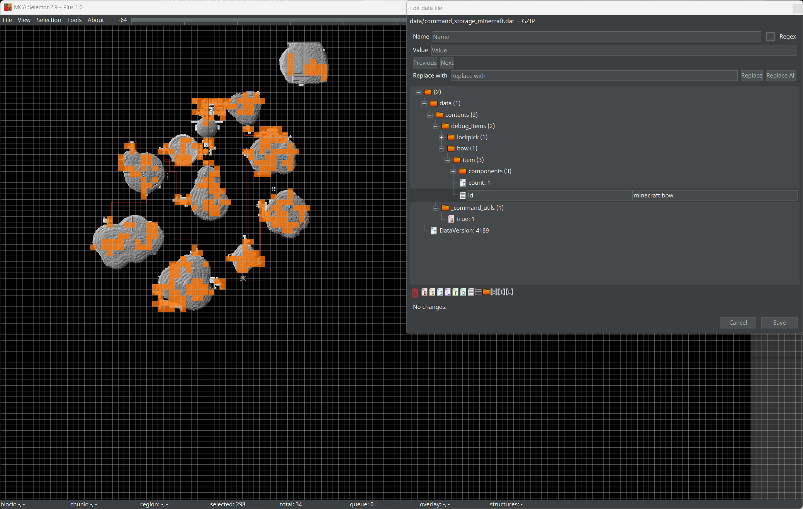

# MCA Selector Plus

#### Select, edit and export chunks and regions of a Minecraft Java Edition world save, plus NBT Studio style
world-wide NBT search and replace, a data file editor and an NBT file browser.

---

  

---

MCA Selector Plus is a fork of [MCA Selector](https://github.com/Querz/mcaselector). The chunk and region
handling, the rendering, the selections and the CLI are the upstream code, kept in sync with
`Querz/mcaselector`; everything Plus adds sits on top of it as an extension layer. The feature list, the
version scheme and the branch model are in **[README-PLUS.md](README-PLUS.md)**, the query syntax and the
CLI reference of the NBT tools in [README-NBT-STUDIO.md](README-NBT-STUDIO.md).

| | |
|---|---|
| Application and installer name | `MCA Selector Plus` |
| Window title, about dialog | `MCA Selector Plus <core version> - Plus <plus version>` |
| Upstream core | `Querz/mcaselector` (unmodified, mirrored on `master`) |
| Bugs and feature requests | this repository, not the upstream one |

**MCA Selector Plus modifies and deletes chunks in your Minecraft world. Please make backups of your world before using.**

## Download

Every asset of a release carries the plus identity:
`mcaselector-plus-<core version>-plus-<plus version>-<platform>`, tag `plus-<core version>-<plus version>`.

[**Download Version <!--vs-->2.9<!--ve--> - Plus <!--pv-->1.0<!--pe--> (Windows Installer)**](https://github.com/RunningVAN/mcaselector-plus/releases/download/plus-<!--vs-->2.9<!--ve-->-<!--pv-->1.0<!--pe-->/mcaselector-plus-<!--vs-->2.9<!--ve-->-plus-<!--pv-->1.0<!--pe--->-setup.exe)

[**Download Version <!--vs-->2.9<!--ve--> - Plus <!--pv-->1.0<!--pe--> (macOS arm64)**](https://github.com/RunningVAN/mcaselector-plus/releases/download/plus-<!--vs-->2.9<!--ve-->-<!--pv-->1.0<!--pe-->/mcaselector-plus-<!--vs-->2.9<!--ve-->-plus-<!--pv-->1.0<!--pe--->-aarch64.dmg)

[**Download Version <!--vs-->2.9<!--ve--> - Plus <!--pv-->1.0<!--pe--> (macOS x64)**](https://github.com/RunningVAN/mcaselector-plus/releases/download/plus-<!--vs-->2.9<!--ve-->-<!--pv-->1.0<!--pe-->/mcaselector-plus-<!--vs-->2.9<!--ve-->-plus-<!--pv-->1.0<!--pe--->-x64.dmg)

[**Download Version <!--vs-->2.9<!--ve--> - Plus <!--pv-->1.0<!--pe--> (DEB arm64)**](https://github.com/RunningVAN/mcaselector-plus/releases/download/plus-<!--vs-->2.9<!--ve-->-<!--pv-->1.0<!--pe-->/mcaselector-plus-<!--vs-->2.9<!--ve-->-plus-<!--pv-->1.0<!--pe--->-aarch64.deb)

[**Download Version <!--vs-->2.9<!--ve--> - Plus <!--pv-->1.0<!--pe--> (DEB x64)**](https://github.com/RunningVAN/mcaselector-plus/releases/download/plus-<!--vs-->2.9<!--ve-->-<!--pv-->1.0<!--pe-->/mcaselector-plus-<!--vs-->2.9<!--ve-->-plus-<!--pv-->1.0<!--pe--->-x64.deb)

[**Download Version <!--vs-->2.9<!--ve--> - Plus <!--pv-->1.0<!--pe--> (RPM arm64)**](https://github.com/RunningVAN/mcaselector-plus/releases/download/plus-<!--vs-->2.9<!--ve-->-<!--pv-->1.0<!--pe-->/mcaselector-plus-<!--vs-->2.9<!--ve-->-plus-<!--pv-->1.0<!--pe--->-aarch64.rpm)

[**Download Version <!--vs-->2.9<!--ve--> - Plus <!--pv-->1.0<!--pe--> (RPM x64)**](https://github.com/RunningVAN/mcaselector-plus/releases/download/plus-<!--vs-->2.9<!--ve-->-<!--pv-->1.0<!--pe-->/mcaselector-plus-<!--vs-->2.9<!--ve-->-plus-<!--pv-->1.0<!--pe--->-x64.rpm)

[**Download Version <!--vs-->2.9<!--ve--> - Plus <!--pv-->1.0<!--pe--> (Universal jar)**](https://github.com/RunningVAN/mcaselector-plus/releases/download/plus-<!--vs-->2.9<!--ve-->-<!--pv-->1.0<!--pe-->/mcaselector-plus-<!--vs-->2.9<!--ve-->-plus-<!--pv-->1.0<!--pe--->.jar)

The jar runs with `java -jar mcaselector-plus-<core>-plus-<plus>.jar`; it is the same application as the
installers, only without a bundled runtime.

## Install

| Platform | Installs to | Command on the `PATH` |
|----------|-------------|-----------------------|
| Windows | `%LOCALAPPDATA%\Programs\MCA Selector Plus` (the installer asks for an elevation and then uses `%ProgramFiles%\MCA Selector Plus`) | start menu entry `MCA Selector Plus` |
| macOS | `/Applications/MCA Selector Plus.app` | - |
| Linux deb/rpm | `/opt/mcaselector-plus` | `/usr/bin/mcaselector-plus` |

MCA Selector Plus uses its own application id, its own install directory and its own uninstaller, so it
installs next to an upstream MCA Selector instead of overwriting it. Settings, the `mcaselector`
configuration directory and the debug log are shared with the upstream application.

## Wiki

The wiki for the shared core is [the upstream one](https://github.com/Querz/mcaselector/wiki).
The Plus layer is documented in this repository.

## Video Tutorials
The upstream tutorials still apply to the core features, since the UI is the same:

* [How To Reset Chunks In Your Minecraft World!](https://www.youtube.com/watch?v=1xx8fwynlRs) by [Farzy](https://www.youtube.com/channel/UCVtz3s3FUxVxBgPl2OWtIJQ)
* [How To Clear Unwanted Chunks In Minecraft 1.16 | MCASelector Tutorial](https://www.youtube.com/watch?v=ADDTXGRJo20) by [Muriako](https://www.youtube.com/channel/UCpt-MjKkc5X4W7bUFV3Dwrw)
* [Preparing Your World for the Nether Update! - The Minecraft Survival Guide](https://www.youtube.com/watch?v=1fiyVvoD9jQ) starting at [2:52](https://www.youtube.com/watch?v=1fiyVvoD9jQ&t=2m52s) by [Pixlriffs](https://www.youtube.com/channel/UCgGjBqZZtAjxfpGSba7d6ww)
* [How To Reset The End Dimension! - The Minecraft Survival Guide](https://www.youtube.com/watch?v=p-2gFkJl_Lo) starting at [8:45](https://www.youtube.com/watch?v=p-2gFkJl_Lo&t=8m45s) by [Pixlriffs](https://www.youtube.com/channel/UCgGjBqZZtAjxfpGSba7d6ww)

---
## Supported Versions
MCA Selector Plus currently supports the following Minecraft versions:

| Minecraft Version | Data Version |
|-------------------|--------------|
| 1.2.1 - 1.12.2    | None - 1343  |
| 1.13 - 1.13.2     | 1444 - 1631  |
| 1.14 - 1.14.4     | 1901 - 1976  |
| 1.15 - 1.15.2     | 2200 - 2230  |
| 1.16 - 1.16.5     | 2566 - 2586  |
| 1.17 - 1.17.1     | 2724 - 2730  |
| 1.18 - 1.18.2     | 2825 - 2975  |
| 1.19 - 1.19.4     | 3105 - 3337  |
| 1.20 - 1.20.6     | 3463 - 3839  |
| 1.21 - 1.21.11    | 3953 - 4671  |
| 26.1 - 26.3+      | 4764 - 5023+ |

There is no guarantee for worlds generated in a Snapshot version to work, even if it is specified in the table above.
This only represents the current development status towards the next Minecraft release. Old Snapshots of past
Minecraft releases are not officially supported.

---
## License

MCA Selector Plus is distributed under the MIT license, the same as the upstream project. The core is
copyright Querz, the Plus layer is copyright RunningVAN; see [LICENSE](LICENSE) and
[README-NBT-STUDIO.md](README-NBT-STUDIO.md) for the attribution.
